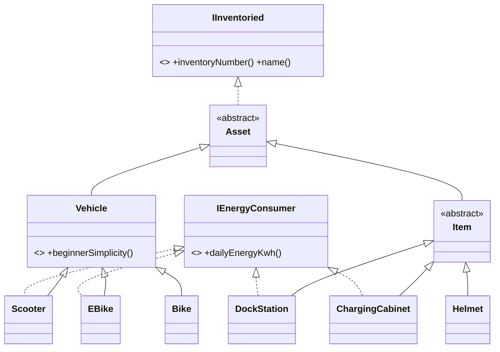

# ВышКат

Консольное приложение для учёта транспорта и инвентаря университетского кикшеринга «ВышКат».
C++20, CMake, GoogleTest + gMock, собственный DI-контейнер.

Что умеет:

- принимать транспорт (самокат, велосипед, электровелосипед) через техосмотр;
- ставить на баланс вещи (шлем, док-станция, зарядный шкаф);
- считать суммарный суточный расход энергии;
- показывать транспорт, подходящий новичкам (простота управления ≥ 6);
- печатать инвентарную ведомость: инвентарный номер и название каждого объекта.

## Сборка и запуск

Нужны CMake ≥ 3.20 и компилятор с C++20 (GCC 11+ или Clang 14+). GoogleTest скачивается сам через `FetchContent`.

```bash
cmake -S . -B build
cmake --build build
./build/vyshkat                      # интерактивный режим
./build/vyshkat < demo/scenario.txt  # демо-сценарий
ctest --test-dir build               # тесты
```

### Демо-сценарий

Данные демо лежат в файле `demo/scenario.txt`, а не в коде: программа читает команды из стандартного ввода, поэтому файл подаётся через `<`. Сценарий проходит все функциональные требования:

| Шаг | Что происходит |
|---|---|
| Самокат SC-001, расход 0.4 | принят |
| Самокат SC-002, расход 2.0 | отказ техосмотра с причиной (расход выше 1.5 кВт·ч) |
| Велосипеды BK-005 и BK-006, простота 5 и 6 | приняты |
| Велосипед с номером SC-001 | отказ: номер уже занят |
| Шлем HL-001, док-станция DS-001 | поставлены на баланс |
| Пункт 3 | 5 объектов, 1.4 кВт·ч в сутки |
| Пункт 4 | для новичков только SC-001 и BK-006 (граница 5/6) |
| Пункт 5 | ведомость всех пяти объектов |

Ввод устойчив к ошибкам: буквы вместо числа и пустая строка приводят к повторному вопросу, конец ввода корректно завершает программу, ошибки конструкторов (простота 11, пустой номер) печатаются как сообщение, программа не падает.

## Структура

```
include/vyshkat/
  domain/    модель: что есть в парке (ни от чего не зависит)
  services/  бизнес-логика: техосмотр, парк, приёмка, отчёты
  di/        DI-контейнер
  ui/        консоль
src/         реализации, те же папки
app/main.cpp composition root: собирает контейнер и запускает консоль
demo/        демо-сценарий
tests/       тесты, tests/mocks/ с моком техосмотра
```

Зависимости идут только в одну сторону: `ui → services → domain`. Контейнер подключается только в `app/main.cpp` и в тестах.

## Модель



Сервисы:

- `IServiceCenter` / `ServiceCenter` — техосмотр: отклоняет транспорт с расходом выше 1.5 кВт·ч в сутки и со слишком сложным управлением (простота < 3). Возвращает `InspectionResult{accepted, reason}`.
- `BeginnerPolicy` — порог простоты для новичков (по умолчанию 6).
- `Fleet` — хранит объекты (`unique_ptr`) и следит за уникальностью инвентарных номеров.
- `FleetService` — приёмка: техосмотр, потом добавление в `Fleet`.
- `FleetReport` — отчёты только для чтения: количество, энергия, новички, ведомость.
- `ConsoleApp` — меню, ввод и вывод через `std::istream&` / `std::ostream&`.

## DI-контейнер

`include/vyshkat/di/Container.hpp`, около 50 строк, только заголовок (шаблоны):

- `registerSingleton<I>(factory)` запоминает рецепт создания типа `I`;
- `resolve<I>()` при первом вызове создаёт объект по рецепту и кэширует его, при следующих возвращает тот же; для незарегистрированного типа бросает `std::runtime_error`.

Что зарегистрировано в `app/main.cpp`:

| Тип | Реализация |
|---|---|
| `Fleet` | `Fleet` |
| `IServiceCenter` | `ServiceCenter` |
| `FleetService` | `FleetService(Fleet, IServiceCenter)` |
| `FleetReport` | `FleetReport(Fleet, BeginnerPolicy())` |

**Почему контейнер только в `main`.** Сервисы получают зависимости через конструктор и о контейнере не знают. Если передать `Container&` внутрь сервиса, получится Service Locator: зависимости класса перестанут быть видны по его конструктору, и класс нельзя будет протестировать без контейнера. Поэтому контейнер живёт только в composition root (`main`) и в тестах.

## Роль ИИ

Использовалась модель **Claude Opus 5.5** (уровень рассуждений medium). Промпты:

1. Помоги написать README.md для моей домашки по КПО. Проект на C++20 с CMake: консольное приложение для учёта кикшеринга ВышКат (самокаты, велосипеды, электровелосипеды, шлемы, док-станции, зарядные шкафы). Есть техосмотр через интерфейс IServiceCenter, учёт энергии через IEnergyConsumer, список для новичков (простота от 6), инвентарная ведомость, свой DI-контейнер, тесты на GoogleTest с моком техосмотра.
2. Проверь покрытие тестов, если каких-то не хватает, то предложи улучшение тестов.
3. Напиши правильное название функций и файлов для моего проекта по предоставленному документу.
4. Расскажи, как правильно структурировать проект и правильно разложить файлы по папкам.
5. Проверь, насколько хорошо реализованы hpp- и cpp-файлы и их зависимости.

## Тесты и покрытие

GoogleTest + gMock, все тесты в `tests/`:

| Файл | Что проверяет |
|---|---|
| `AssetTest`, `VehicleTest`, `VehicleKindsTest`, `ItemsTest` | инварианты конструкторов, кто потребляет энергию |
| `ServiceCenterTest` | приём, отказ по расходу и по сложности, причина не пустая |
| `BeginnerPolicyTest` | граница 5 / 6 |
| `FleetTest` | хранение, дубликат номера |
| `FleetServiceTest` | **подмена техосмотра моком через контейнер**, дубликаты, вещи без техосмотра |
| `FleetReportTest` | энергия (0 у велосипеда и шлема, сумма у самоката и док-станции), ведомость, новички |
| `ContainerTest` | один объект на тип, ленивое создание, исключение для незарегистрированного типа |
| `ConsoleAppTest` | меню через `stringstream`, мусорный ввод, конец ввода, ошибки ввода |

Покрытие:

```bash
cmake -S . -B build-cov -DENABLE_COVERAGE=ON
cmake --build build-cov
ctest --test-dir build-cov
gcovr -r . --filter src/ --filter include/ build-cov
```

Покрытие строк: **85%** (294 из 345, все 68 тестов проходят). Доменная модель, `ServiceCenter`, `FleetService` и `BeginnerPolicy` покрыты на 100%, `Fleet` и `FleetReport` на 93%. Меньше всего покрыт `ConsoleApp` (75%): часть веток ввода в тестах не проходится.
